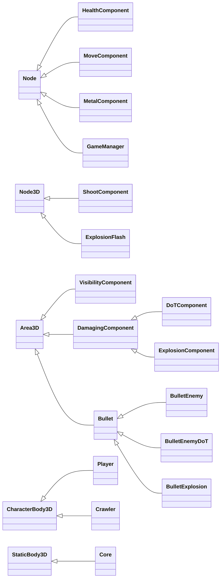
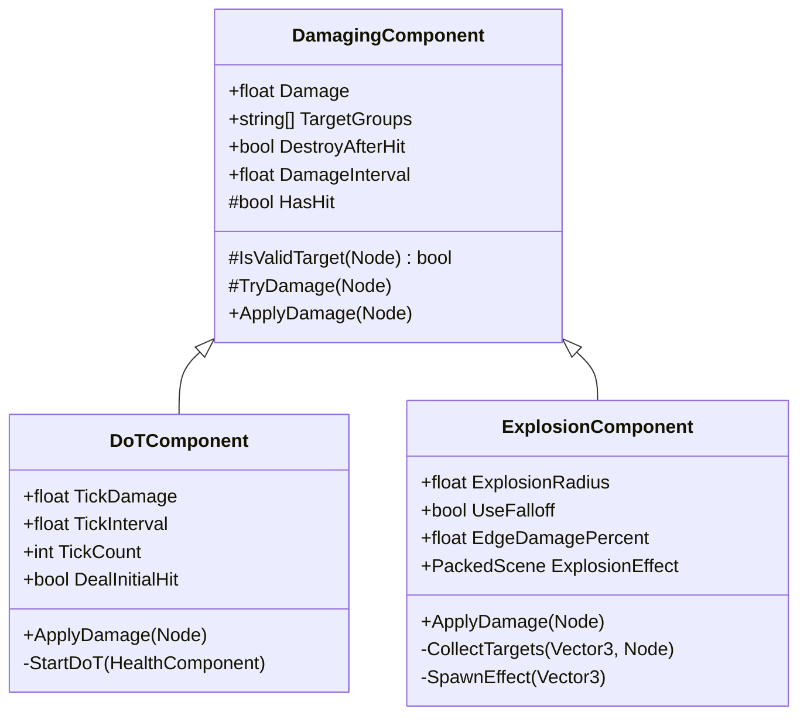
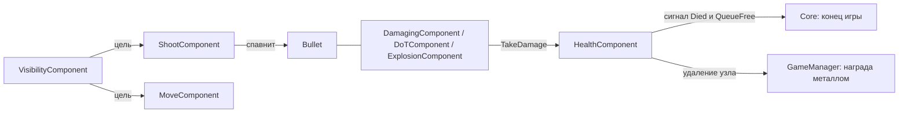

# Прототип Tower Defense (Лабораторная работа 3)

## Описание проекта

3D-прототип игры в жанре Tower Defense на движке **Godot 4** с использованием **C#**.
Проект развивает прототип Base Defense из Практики 3 и сохраняет его
компонентную архитектуру: игровые сущности (игрок, башни, враги, пули) собираются
из независимых узлов-компонентов, а баланс настраивается через инспектор.

Игрок защищает **Ядро** от врагов: ходит по карте, стреляет, ставит башни за металл.
Если Ядро уничтожено, игра заканчивается.

## Управление

| Действие | Клавиши |
|---|---|
| Движение | `W` `A` `S` `D` |
| Поворот | движение мыши (игрок смотрит на курсор) |
| Стрельба | ЛКМ или `Пробел` |
| Режим постановки башни | `E` (показывает «призрачную» башню перед игроком) |
| Выбор типа башни | `1`–`9` или `Tab` (пока виден призрак) |
| Установить башню | повторное `E` |
| Отмена постановки | `Esc` |

Действия ввода создаются из кода (`Player.RegisterInputActions`), настройка InputMap вручную не нужна.

## Структура проекта

```
res://
├── Components/                  # Переиспользуемые компоненты 
│   ├── HealthComponent.cs       # здоровье, смерть, сигнал Died
│   ├── MoveComponent.cs         # движение к цели
│   ├── ShootComponent.cs        # стрельба по цели
│   ├── VisibilityComponent.cs   # поиск цели
│   ├── DamagingComponent.cs     # базовый компонент урона
│   ├── DoTComponent.cs          # урон со временем 
│   ├── ExplosionComponent.cs    # урон по площади 
│   └── MetalComponent.cs        # цена постройки и награда за уничтожение
├── Scripts/                     # Скрипты корневых узлов сцен
│   ├── GameManager.cs           # экономика металла, интерфейс, награды
│   ├── Player.cs                # игрок: движение, стрельба, постановка башен
│   ├── Core.cs                  # ядро: конец игры при уничтожении
│   ├── Crawler.cs               # враг-краулер 
│   ├── Bullet.cs                # базовая пуля 
│   ├── BulletEnemy.cs           # пуля врага
│   ├── BulletEnemyDoT.cs        # пуля врага с эффектом DoT
│   ├── BulletExplosion.cs       # взрывная пуля
│   └── ExplosionFlash.cs        # визуальный эффект взрыва
├── Scenes/
│   ├── GameField.tscn           # основная игровая сцена 
│   ├── Player.tscn              # игрок
│   ├── Core.tscn                # ядро
│   ├── Tower.tscn               # обычная башня игрока
│   ├── TowerExplosion.tscn      # взрывная башня игрока
│   ├── ExplosionEffect.tscn     # вспышка взрыва
│   ├── Bullet/
│   │   ├── Bullet.tscn          # пуля игрока и башен игрока
│   │   ├── BulletEnemy.tscn     # пуля обычной вражеской башни
│   │   ├── BulletEnemyDoT.tscn  # пуля вражеской DoT-башни
│   │   └── BulletExplosion.tscn # пуля взрывной башни
│   └── Enemy/
│       ├── Enemy.tscn           # обычная вражеская башня
│       ├── EnemyDoT.tscn        # вражеская башня с уроном со временем
│       └── Crawler.tscn         # враг
├── icon.svg
└── README.md
```

## Структура сцен

## GameField.tscn (игровое поле)

Корневой узел `Field` (`Node3D`) со скриптом **GameManager**.

```
Field (Node3D, GameManager.cs)
├── WorldEnvironment
├── Floor
│   ├── StaticBody3D / CollisionShape3D     # пол
│   └── MeshInstance3D                       # меш пола
├── Camera3D                                 # вид сверху
├── Core            (экземпляр Core.tscn)
├── Player          (экземпляр Player.tscn)
├── Light / DirectionalLight3D
└── Enemy
    ├── StandartEnemyTower   → 3 × Enemy.tscn
    ├── DoTEnemyTower        → 4 × EnemyDoT.tscn
    └── Zombie               → 4 × Crawler.tscn
```

## Player.tscn

```
Player (CharacterBody3D, Player.cs, группа Player)
├── MeshInstance3D
├── CollisionShape3D
└── HealthComponent                 # 500 HP
```
Экспортируемые параметры: `BulletScene = Bullet.tscn`, `TowerScenes = [Tower, TowerExplosion]`.

## Core.tscn

```
Core (StaticBody3D, Core.cs, группа Core)
├── MeshInstance3D
├── CollisionShape3D
└── HealthComponent                 # 500 HP
```

## Tower.tscn и TowerExplosion.tscn (башни игрока)

Обе сцены устроены одинаково и различаются только сценой пули.

```
Tower / TowerExplosion (CharacterBody3D, группа Tower)
├── MeshInstance3D                  # корпус
├── CollisionShape3D
├── HealthComponent                 # 100 HP
├── VisibilityComponent (Area3D)    # TargetGroups = Enemy
│   └── CollisionShape3D            # зона обнаружения
├── ShootComponent (Node3D)         # BulletScene: Bullet.tscn / BulletExplosion.tscn
│   └── MeshInstance3D              # ствол
└── MetalComponent                  # Cost = 10, Reward = 20
```

## Enemy.tscn и EnemyDoT.tscn (вражеские башни)

```
Enemy / EnemyDoT (CharacterBody3D, группа Enemy)
├── MeshInstance3D
├── CollisionShape3D
├── HealthComponent                 # Enemy: 20 HP, EnemyDoT: 50 HP
├── MoveComponent                   # Speed = 1
├── ShootComponent (Node3D)         # BulletEnemy.tscn / BulletEnemyDoT.tscn
│   └── MeshInstance3D
├── VisibilityComponent (Area3D)    # TargetGroups = Core, Tower, Player
│   └── CollisionShape3D
└── MetalComponent                  # Cost = 10, Reward = 20
```

## Crawler.tscn (враг-краулер)

```
Zombie (CharacterBody3D, группа Enemy)
├── CollisionShape3D
├── Mesh (MeshInstance3D)
├── HealthComponent                 # 100 HP
├── MoveComponent                   # Speed = 5, StopRadius = 0
├── DamagingComponent (Area3D)      # урон при контакте
│   └── CollisionShape3D            # зона больше тела краулера
│                                   # DamageInterval = 1, DestroyAfterHit = false
│                                   # TargetGroups = Tower, Core, Player
├── VisibilityComponent (Area3D)    # TargetGroups = Tower, Core, Player
│   └── CollisionShape3D
└── MetalComponent                  # Cost = 10, Reward = 20
```
Краулер не стреляет: он идёт к ближайшей цели и наносит ей урон при контакте.

## Сцены пуль

Каждая пуля — `Area3D` со скриптом (наследник `Bullet`), мешем, коллизией и
компонентом урона. Различаются они компонентом урона и целями.

| Сцена | Скрипт | Компонент урона | Цели (`TargetGroups`) | Особенности |
|---|---|---|---|---|
| `Bullet.tscn` | `Bullet` | `DamagingComponent` | Enemy | пуля игрока и башен игрока, зелёная |
| `BulletEnemy.tscn` | `BulletEnemy` | `DamagingComponent` | Tower, Core, Player | пуля обычной вражеской башни |
| `BulletEnemyDoT.tscn` | `BulletEnemyDoT` | `DoTComponent` | Tower, Core, Player | `TickDamage = 8`, `TickInterval = 0.5` |
| `BulletExplosion.tscn` | `BulletExplosion` | `ExplosionComponent` | Enemy | `ExplosionRadius = 10`, без затухания, эффект `ExplosionEffect.tscn` |

## ExplosionEffect.tscn

Один узел `Node3D` со скриптом `ExplosionFlash`. Меш и материал создаются из кода,
поэтому дополнительных узлов не нужно.

## Группы

| Группа | Кто состоит |
|---|---|
| `Player` | игрок |
| `Tower` | башни игрока (`Tower`, `TowerExplosion`) |
| `Enemy` | вражеские башни и краулеры |
| `Core` | ядро |

## Компоненты

Все компоненты помечены `[GlobalClass]`,
классы объявлены `partial`, настраиваемые параметры вынесены в `[Export]`.

| Компонент | Базовый тип | Назначение |
|---|---|---|
| **HealthComponent** | `Node` | Хранит здоровье (`MaxHealth`). `TakeDamage(float)` уменьшает его; при нуле испускает сигнал `Died` и удаляет родителя (`QueueFree`). Защищён от повторной смерти. |
| **MoveComponent** | `Node` | Двигает родительский `CharacterBody3D` к цели со скоростью `Speed`, останавливается на расстоянии `StopRadius`. Без цели идёт к центру карты. Проверяет, что цель не удалена. |
| **ShootComponent** | `Node3D` | Поворачивает ствол к цели, стреляет с частотой `FireRate`, спавнит `BulletScene`, передаёт ей скорость и урон. Компонент урона в пуле ищет по типу, поэтому подходят любые наследники `DamagingComponent`. |
| **VisibilityComponent** | `Area3D` | Датчик обнаружения. Берёт в список только тела из `TargetGroups`, у которых есть `HealthComponent`. Выбирает ближайшую цель и передаёт её в `ShootComponent` и `MoveComponent`. Очищает список от удалённых объектов. |
| **DamagingComponent** | `Area3D` | Базовый компонент урона. Проверяет группы цели (`TargetGroups`), наносит `Damage` через `HealthComponent.TakeDamage`. `DestroyAfterHit` удаляет владельца (пулю). `DamageInterval > 0` включает постоянный урон по всем целям в зоне (краулер). |
| **DoTComponent** | наследник `DamagingComponent` | Урон со временем: начальный удар (`Damage`), затем `TickCount` тиков по `TickDamage` каждые `TickInterval` секунд. Таймер эффекта вешается на цель, поэтому действует и после исчезновения пули. Повторное попадание продлевает эффект, а не накладывает новый. |
| **ExplosionComponent** | наследник `DamagingComponent` | Урон по площади: все цели из `TargetGroups` в радиусе `ExplosionRadius` от точки попадания. Урон может ослабевать к краю (`UseFalloff`, `EdgeDamagePercent`). Создаёт эффект `ExplosionEffect`. |
| **MetalComponent** | `Node` | Хранит экономику объекта: `Cost` (цена постройки башни) и `Reward` (награда за уничтожение). Значения задаются в сцене объекта. |

Скрипты корневых узлов:

| Скрипт | Базовый тип | Назначение |
|---|---|---|
| **GameManager** | `Node` | Корень игрового поля. Хранит металл, рисует счётчик на экране, принимает оплату за постройку и начисляет награды за уничтоженные объекты. |
| **Player** | `CharacterBody3D` | Управление игроком, стрельба, постановка башен. |
| **Core** | `StaticBody3D` | При смерти ядра показывает «GAME OVER», ставит игру на паузу и предлагает перезапуск. |
| **Bullet** | `Area3D` | Только полёт пули вперёд по оси −Z. Урон наносит компонент в её сцене. |
| **ExplosionFlash** | `Node3D` | Визуальный эффект взрыва: растущая и исчезающая сфера. |

## Иерархия компонентов

## Наследование классов


## Ветка компонентов урона



## Взаимодействие компонентов



## Состав сцен по компонентам

| Сцена | Health | Move | Shoot | Visibility | Damaging | Metal |
|---|---|---|---|---|---|---|
| Player | 500 | – | (в `Player.cs`) | – | – | – |
| Core | 500 | – | – | – | – | – |
| Tower | 100 | – | Bullet | Enemy | – | 10 / 20 |
| TowerExplosion | 100 | – | BulletExplosion | Enemy | – | 10 / 20 |
| Enemy | 20 | Speed 1 | BulletEnemy | Core, Tower, Player | – | 10 / 20 |
| EnemyDoT | 50 | Speed 1 | BulletEnemyDoT | Core, Tower, Player | – | 10 / 20 |
| Crawler | 100 | Speed 5 | – | Tower, Core, Player | контакт | 10 / 20 |


## Логика

## 1. Компоненты урона
Раньше урон наносила сама пуля (`Bullet.cs`). Теперь вся логика урона вынесена в
компонент **DamagingComponent**, а пуля только летит. Один и тот же компонент
используется на пулях и на враге-краулере. От него наследуются два новых
компонента:
- **DoTComponent**: урон со временем (горение, яд);
- **ExplosionComponent**: урон по площади с визуальным эффектом.

## 2. Игрок
Новая сущность `Player`: ходьба на WASD, поворот к курсору (луч из камеры через
курсор пересекается с плоскостью на высоте игрока), стрельба по ЛКМ или пробелу,
собственное здоровье. Игрок состоит в группе `Player`, поэтому враги считают его целью.

## 3. Постановка башен
Интерактивная механика: `E` создаёт «призрачную» башню перед игроком. Призрак
строится из сцены башни: копируются только меши с их позициями и заменяется материал
на полупрозрачный. Узлы коллизий, скрипты и компоненты в призрак не попадают, поэтому
он не стреляет и не сталкивается. Тип башни выбирается клавишами, повторное `E`
ставит настоящую башню.

## 4. Ядро и конец игры
Ядро (`Core`) состоит в группе `Core` и имеет `HealthComponent`. При его гибели
срабатывает сигнал `Died`: игра ставится на паузу и показывается экран «GAME OVER» с
кнопкой перезапуска.

## 5. Враг-краулер
Краулер ходит к ближайшей цели (`VisibilityComponent` + `MoveComponent`) и наносит
урон при контакте через `DamagingComponent` с `DamageInterval = 1`: урон
повторяется каждую секунду, пока цель находится в его зоне.

## 6. Система металла (дополнительное задание)
- **MetalComponent** хранит в сцене объекта цену постройки (`Cost`) и награду (`Reward`).
- **GameManager**, прикреплённый к корню игрового поля, хранит запас металла и показывает
  его на экране. Он подписан на удаление узлов со сцены: когда удаляется уничтоженный
  враг или башня с `MetalComponent`, игроку начисляется награда. При перезапуске
  сцены награды не начисляются.
- При попытке поставить башню `GameManager` списывает цену. Если металла не хватает,
  башня не ставится, счётчик вспыхивает красным, появляется надпись
  «Недостаточно металла!», а призрак окрашивается в красный.

## 7. Изменения в существующих компонентах
- **HealthComponent**: добавлен сигнал `Died` и защита от повторной смерти.
- **VisibilityComponent**: цели задаются списком `TargetGroups` вместо жёстко заданных
  групп; удалённые объекты убираются из списка целей.
- **MoveComponent**: проверка, что цель не удалена, чтобы не обращаться к освобождённому объекту.
- **ShootComponent**: компонент урона в пуле ищется по типу, а не по имени узла, поэтому
  работают любые наследники `DamagingComponent`.

Осокина Екатерина Алексеевна 562035
